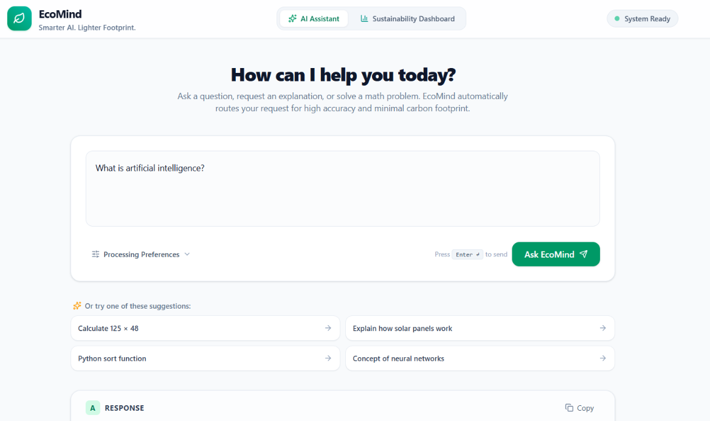
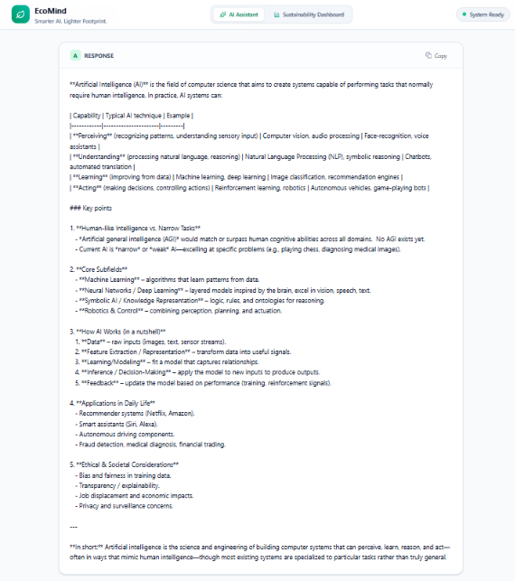
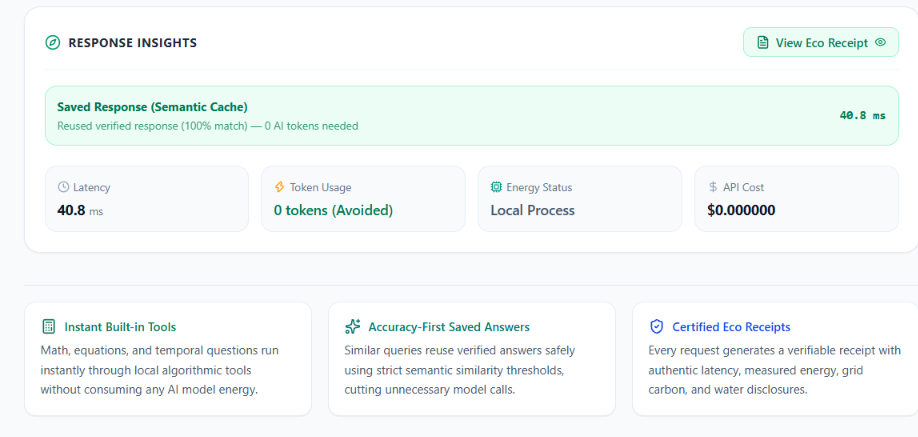
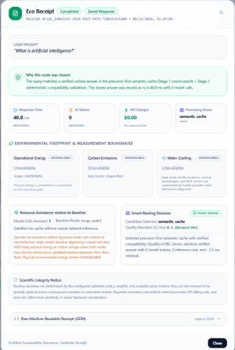
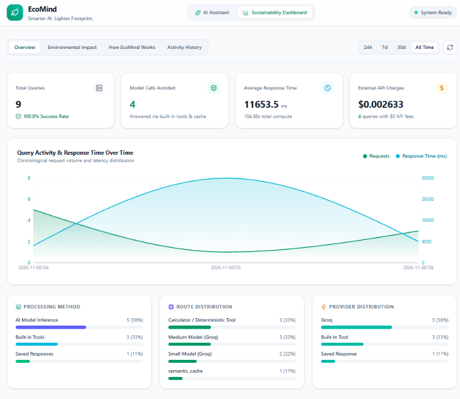
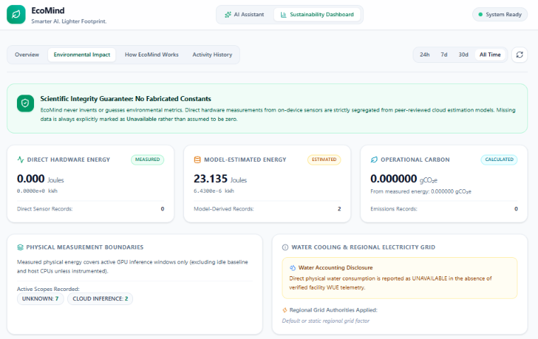
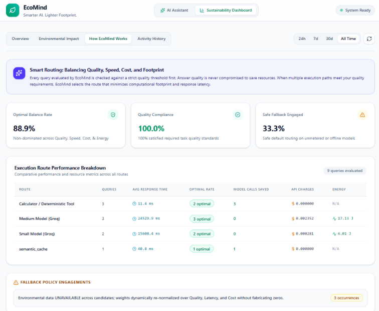
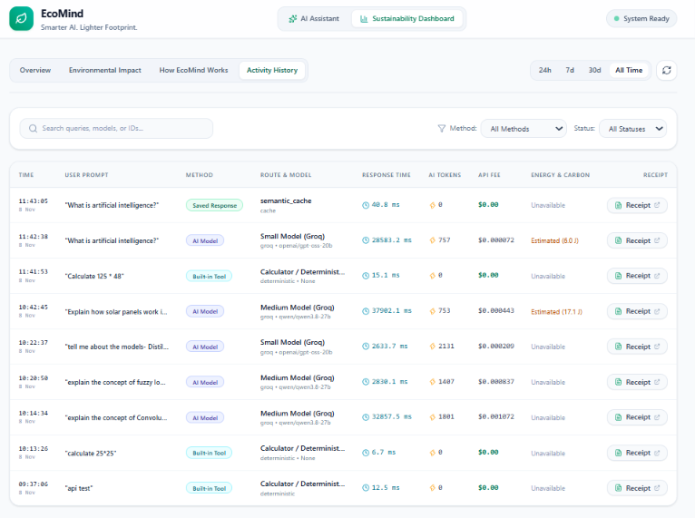

# EcoMind — Sustainability-aware AI Inference Control Plane

## Project Overview & Core Problem
Modern AI systems often send every user query to a relatively large model even when the query could be answered using deterministic tools, a semantic cache, or a smaller model. EcoMind is a sustainability-aware inference control plane that investigates whether an intelligent router can select a lower-resource execution path while maintaining a required level of answer quality and latency.

The system considers query complexity, model capability, estimated energy, water, carbon impact, and latency to optimize the execution route.

## Demo Screenshots









## System Architecture & Flow
1. **User Query**: Received via the API.
2. **Query Analyzer**: Heuristically classifies task type and complexity.
3. **Semantic Cache Check**: If the query is highly similar to a previous query, return the cached answer.
4. **Candidate Generation**: Generates eligible execution paths (Deterministic Tools, Cache, Small Model, Medium Model, Large Model).
5. **Multi-Objective Optimizer**: Evaluates candidates based on quality requirements, latency constraints, and environmental estimates.
6. **Provider Execution**: Dispatches to the chosen model or deterministic tool.
7. **Eco Receipt Generation**: Returns the answer with a detailed environmental impact breakdown.

## Environmental Methodology & Research Integrity
- **Authentic Telemetry**: We record actual measured values (execution latency, authentic API prompt/completion tokens, and local NVIDIA GPU hardware sensor power via NVML).
- **Evidence-Grounded Cloud Estimation (Phase 5B)**: When `ENABLE_CLOUD_ENERGY_ESTIMATION=true`, cloud LLM energy is estimated using peer-reviewed empirical models (**ML.ENERGY Leaderboard v3.0** on NVIDIA H100 testbeds and **EcoLogits LCA**). Output is strictly badged as `ESTIMATED` with uncertainty bounds ($\pm 20\%$) and upstream citations.
- **Strict Anti-Fabrication Safeguard**: Because commercial cloud providers treat data center locations and cooling facility designs as trade secrets, direct water consumption and cloud grid carbon are truthfully disclaimed rather than guessing.
- **Large-Model Inference Avoidance**: Deterministic tools (e.g. AST Calculator, Unit Converter, DateTime) solve calculable tasks with 0 token consumption, bypassing neural network inference entirely.

## Project Structure
```text
backend/
├── main.py                     # FastAPI application entrypoint
├── api/
│   ├── routes_chat.py          # /chat, /tools, /models, /telemetry endpoints
│   ├── routes_dashboard.py     # /dashboard/summary, /environment, /routes, /timeseries, /receipts
│   ├── schemas.py              # Pydantic v2 request/response schemas
│   └── schemas_dashboard.py    # Pydantic v2 dashboard analytics schemas
├── database/
│   ├── __init__.py             # Database package exports
│   └── historical_store.py     # Persistent SQLite Historical Store for telemetry & Eco Receipts
├── models/
│   ├── provider.py             # ModelProvider base class & ProviderResponse
│   ├── gemini_provider.py      # Google GenAI provider with authentic token usage
│   ├── groq_provider.py        # Groq LPU provider with authentic token usage
│   ├── local_provider.py       # Ollama integration with generic measurement provider sampling
│   └── model_profiles.py       # Catalog for small, medium, large tiers
├── router/
│   ├── query_analyzer.py       # Heuristic task type & complexity analyzer
│   ├── routing_policy.py       # Route policy & optimizer dispatcher
│   └── optimizer.py            # Multi-Objective Routing Optimizer (Pareto + normalized scalar scoring)
├── receipt/
│   ├── __init__.py             # Eco Receipt module exports
│   ├── schemas.py              # EcoReceipt, CostMetric, EnergyMetric, CarbonMetric, WaterMetric, OptimizerSummary
│   └── receipt_generator.py    # Honest, explainable receipt generator with Non-Zero safeguards
├── telemetry/
│   ├── __init__.py             # Telemetry module exports
│   ├── schemas.py              # TelemetryRecord, ProvenanceStatus, GpuTelemetry, PhysicalMeasurement, SavingsComparison
│   ├── measurement.py          # Generic MeasurementProvider interface (NvidiaNvml, Android, Apple, Unavailable)
│   ├── gpu.py                  # High-speed NVML / nvidia-smi GPU power & energy sampler
│   ├── savings.py              # Pair-Wise Environmental Savings Integrity Engine (Non-Zero Rule)
│   └── telemetry.py            # Central thread-safe TelemetryCollector with conditional carbon & avoidance
├── tools/
│   ├── base.py                 # BaseTool & ToolResult abstractions
│   ├── calculator.py           # Safe AST-based deterministic calculator
│   ├── unit_converter.py       # Deterministic length/mass/temperature converter
│   ├── datetime_calculator.py  # Deterministic date arithmetic & calendar operations
│   ├── statistics_tool.py      # Deterministic descriptive statistics (mean, median, stdev, etc.)
│   ├── text_analyzer.py        # Deterministic text metrics (word/char/sentence count, frequency)
│   └── tool_registry.py        # Central tool registry & candidate matcher
├── config/
│   └── settings.py             # Application settings (including HISTORICAL_DB_PATH, LOCAL_GRID_INTENSITY_GCO2E_PER_KWH)
└── tests/
    ├── test_calculator.py          # Unit tests for Calculator arithmetic & safety
    ├── test_unit_converter.py      # Unit tests for UnitConverter dimensions & edge cases
    ├── test_datetime_calculator.py  # Unit tests for date differences, offsets, weekdays
    ├── test_statistics_tool.py     # Unit tests for mean, median, min, max, stdev, summary
    ├── test_text_analyzer.py       # Unit tests for word/char/sentence count & word frequency
    ├── test_tool_registry.py       # Unit tests for ToolRegistry & candidate matching
    ├── test_router.py              # Unit tests for initial query analysis & routing
    ├── test_models.py              # Unit tests for ModelProfile & providers
    ├── test_groq_provider.py       # Unit tests for Groq provider
    ├── test_dispatcher.py          # Unit tests for ModelDispatcher
    ├── test_semantic_cache.py      # Unit tests for Precision-First Semantic Cache
    ├── test_telemetry.py           # Unit tests for Phase 5A measurement infrastructure
    ├── test_environmental_accounting.py # Unit tests for Phase 5B environmental accounting & Non-Zero Rule
    ├── test_environmental_accounting_upgrade.py # Unit tests for Phase 5B upgrade (source registry, cloud estimators, grid & water)
    ├── test_optimizer.py           # Unit & integration tests for Phase 6 Multi-Objective Optimizer (17 tests)
    ├── test_eco_receipt.py         # Unit & integration tests for Phase 7 Eco Receipt Generation (18 tests)
    ├── test_dashboard.py           # Unit & integration tests for Phase 8 Historical Store & Dashboard (10 tests)
    └── test_api.py                 # Integration tests for FastAPI endpoints
frontend/                       # React 19 + Vite 8 + Tailwind CSS v4 + Recharts dashboard
run_ecomind.bat                 # Unified single-command launcher for Windows
```

## Running EcoMind Locally

EcoMind provides a unified, single-command launcher (`run_ecomind.bat`) for Windows that starts both the FastAPI backend and Vite React frontend in separate dedicated terminal windows with full prerequisite and port conflict validation.

### Prerequisites

* **Operating System**: Windows 10/11 (for `run_ecomind.bat`).
* **Python**: Python 3.10+ (ensure "Add Python to PATH" is checked during installation).
* **Node.js**: Node.js LTS v18+ (bundled with `npm`).
* **Model Provider API Keys** (Optional for local deterministic tools, cache, and Ollama; required for cloud tiers):
  * Groq API Key (`GROQ_API_KEY`)
  * Google Gemini API Key (`GOOGLE_API_KEY`)

### First-Time Setup Instructions

Before running the launcher for the first time, set up the backend virtual environment and frontend node packages:

1. **Configure Backend Environment**:
   ```bash
   cd backend
   copy .env.example .env
   ```
   Open `backend/.env` and insert your API keys if you plan to dispatch to cloud models.

2. **Set Up Python Virtual Environment**:
   ```bash
   python -m venv venv
   .\venv\Scripts\activate
   pip install -r requirements.txt
   cd ..
   ```

3. **Install Frontend Dependencies**:
   ```bash
   cd frontend
   npm install
   cd ..
   ```

### Launching with `run_ecomind.bat`

Once the initial dependencies are installed, you can launch the complete system from the project root at any time:

* **From File Explorer**: Double-click `run_ecomind.bat`.
* **From Command Prompt / PowerShell**:
  ```cmd
  run_ecomind.bat
  ```

The launcher will:
1. Verify system prerequisites (`python`, `node`, `npm` in PATH).
2. Validate backend virtual environment (`backend/venv`) and `uvicorn`.
3. Validate frontend dependencies (`frontend/node_modules`).
4. Check for port conflicts on port `8000` (backend) and port `5173` (frontend).
5. Open two dedicated terminal windows:
   * **Window 1 (Backend)**: Runs FastAPI with hot-reload via `uvicorn main:app --host 127.0.0.1 --port 8000 --reload`.
   * **Window 2 (Frontend)**: Runs Vite dev server via `npm run dev`.

### Application URLs

* **Frontend Dashboard & Playground**: [http://localhost:5173](http://localhost:5173)
* **Backend API Root**: [http://127.0.0.1:8000](http://127.0.0.1:8000)
* **Interactive API Documentation (Swagger)**: [http://127.0.0.1:8000/docs](http://127.0.0.1:8000/docs)
* **Alternative API Documentation (ReDoc)**: [http://127.0.0.1:8000/redoc](http://127.0.0.1:8000/redoc)

### How to Stop the Application

* **Stopping Services**: Press `Ctrl + C` in either terminal window to stop that service.
* **Full Termination**: Close both terminal windows.

### Common Startup Errors & Solutions

| Error | Root Cause | Exact Resolution |
|---|---|---|
| `[ERROR] Python is not installed or not found in system PATH` | Python is missing from your system PATH | Download Python 3.10+ from [python.org](https://www.python.org/downloads/) and re-run installer, ensuring **"Add Python to PATH"** is checked. |
| `[ERROR] Node.js is not installed or not found in system PATH` | Node.js is missing | Install Node.js LTS v18+ from [nodejs.org](https://nodejs.org/) and restart your command prompt. |
| `[ERROR] Backend Python virtual environment not found` | Virtual environment was not created | Run `cd backend && python -m venv venv && venv\Scripts\activate && pip install -r requirements.txt`. |
| `[ERROR] uvicorn is not installed in the virtual environment` | Backend requirements were not installed | Run `cd backend && venv\Scripts\activate && pip install -r requirements.txt`. |
| `[ERROR] Frontend node_modules directory not found` | npm packages not installed | Run `cd frontend && npm install`. |
| `[WARNING] Port 8000 is currently in use` | A previous backend instance or another service is bound to port 8000 | Find and terminate the process: `netstat -ano \| findstr :8000` followed by `taskkill /PID <PID> /F`. |
| `[WARNING] Port 5173 is currently in use` | Vite dev server already running | Vite will automatically offer port `5174`, or you can terminate the existing process: `netstat -ano \| findstr :5173` followed by `taskkill /PID <PID> /F`. |

---

## Docker Setup & Containerization

EcoMind provides complete containerization via Docker and Docker Compose for reproducible, zero-configuration local runs across Windows, macOS, and Linux.

### Container Architecture

```
                      ┌──────────────────────────────────────┐
                      │             User Browser             │
                      └──────────────────┬───────────────────┘
                                         │ http://localhost:5173
                                         ▼
                 ┌──────────────────────────────────────────────────┐
                 │       ecomind-frontend Container (Nginx)         │
                 │   - Serves React 19 SPA static assets            │
                 │   - Reverse-proxies /api/ and API routes         │
                 └───────────────────────┬──────────────────────────┘
                                         │ http://backend:8000
                                         ▼
                 ┌──────────────────────────────────────────────────┐
                 │        ecomind-backend Container (FastAPI)       │
                 │   - Multi-Objective Routing Optimizer            │
                 │   - Environmental Accounting & Telemetry Engine  │
                 │   - Non-root user: ecomind (UID 1000)            │
                 └───────────────────────┬──────────────────────────┘
                                         │ Mounts: /app/database
                                         ▼
                 ┌──────────────────────────────────────────────────┐
                 │    Named Volume: ecomind-database-volume         │
                 │   - historical_telemetry.db (Phase 8 SQLite)     │
                 │   - semantic_cache.db & semantic_cache.index     │
                 └──────────────────────────────────────────────────┘
```

### Docker Prerequisites

* **Docker Desktop** (Windows/macOS) or **Docker Engine & Docker Compose v2** (Linux).
* Verify installation:
  ```bash
  docker --version
  docker-compose --version
  ```

### Quickstart with Docker Compose

1. **Configure Environment Variables**:
   Copy the example environment file to `.env` in the project root:
   ```bash
   cp .env.example .env
   # On Windows Command Prompt:
   copy .env.example .env
   ```
   Add your `GROQ_API_KEY` (and optional `GOOGLE_API_KEY`) to `.env`.

2. **Build and Start All Services**:
   ```bash
   docker-compose up --build
   ```
   *(Or `docker compose up --build` if using the Docker Compose plugin).*

   To run in the background (detached mode):
   ```bash
   docker-compose up -d --build
   ```

3. **Access the Applications**:
   * **Frontend Web Application**: [http://localhost:5173](http://localhost:5173)
   * **Backend API & Swagger Docs**: [http://localhost:8000/docs](http://localhost:8000/docs)
   * **Backend Health Check**: [http://localhost:8000/](http://localhost:8000/)

4. **View Container Logs**:
   ```bash
   # Follow all logs
   docker-compose logs -f

   # Follow backend logs only
   docker-compose logs -f backend
   ```

5. **Stop the Application**:
   ```bash
   docker-compose down
   ```
   *Note: Stopping containers does **not** erase your data. Your SQLite databases remain safely preserved in the named Docker volume.*

### Database Persistence & Data Volume

All historical telemetry records, Eco Receipts, and FAISS vector cache indexes are stored in the persistent named volume `ecomind-database-volume` mounted at `/app/database`.

* Rebuilding containers (`docker-compose up --build`) preserves all historical data.
* To reset all stored data if needed:
  ```bash
  docker-compose down -v
  ```

### Hardware Telemetry in Docker (NVIDIA NVML)

EcoMind includes native NVIDIA NVML telemetry via low-level C-library bindings (`ctypes.CDLL`).

* **Standard Containers (Default)**: In standard CPU container environments without GPU passthrough, NVML access is gracefully unavailable. EcoMind's `UnavailableProvider` reports physical GPU energy as `UNAVAILABLE` with zero fabricated metrics (strictly adhering to the Anti-Fabrication Safeguard). Cloud estimation (ML.ENERGY / EcoLogits) continues to function as configured.
* **NVIDIA GPU Passthrough**: If running on a host with an NVIDIA GPU and the **NVIDIA Container Toolkit** installed, GPU sampling can be enabled by passing `--gpus all` or configuring the NVIDIA runtime in Compose.

---

## GitHub Actions Continuous Integration (CI) Pipeline

EcoMind includes a fully automated Continuous Integration pipeline defined in [`.github/workflows/ci.yml`](.github/workflows/ci.yml). The pipeline automatically runs on every `push` and `pull_request` targeting the `main` branch.

### CI Workflow Architecture

The CI pipeline consists of 3 distinct, parallel and dependent jobs:

1. **`backend-ci` (Backend Test Suite & Type Verification)**:
   * Sets up Python 3.10 with pip dependency caching.
   * Installs all dependencies from `backend/requirements.txt`.
   * Executes the complete unit test suite (201 passing tests across all components) using dummy API credentials and offline huggingface flags (`HF_HUB_OFFLINE=1`).
   * Validates: Deterministic tools, Query Analyzer, Model Dispatcher, Semantic Cache, Multi-Objective Optimizer, Environmental Accounting, and Historical Telemetry Store.

2. **`frontend-ci` (TypeScript Validation & Production Build)**:
   * Sets up Node.js 20 with npm package caching.
   * Executes clean dependency installation via `npm ci`.
   * Runs strict TypeScript type checking (`npx tsc -b`) to verify zero type errors.
   * Builds the production Vite bundle (`npm run build`) to ensure zero asset compilation issues.

3. **`docker-verification` (Container Build Verification)**:
   * Runs after `backend-ci` and `frontend-ci` pass successfully.
   * Tests multi-stage Docker builds for both `backend/Dockerfile` and `frontend/Dockerfile`.
   * Validates Docker layer caching, dependency resolution, and non-root user configuration inside Linux containers.
   * **Strictly CI verification only**: No external image pushing or public deployment.

---

## Setup & Installation (Manual Alternative)

### Environment Variables
Create a `.env` file in the `backend/` directory:
```env
ENVIRONMENT=development
GOOGLE_API_KEY=your_gemini_api_key
GEMINI_DEFAULT_MODEL=gemini-2.5-flash
OLLAMA_BASE_URL=http://localhost:11434
LOCAL_PROVIDER_FALLBACK=True
```

### Running Backend
```bash
cd backend
python -m venv venv
.\venv\Scripts\activate  # Windows
# source venv/bin/activate  # Mac/Linux
pip install -r requirements.txt
uvicorn main:app --reload
```

### Running Tests
```bash
cd backend
python -m unittest discover tests
```

### Running Frontend
```bash
cd frontend
npm install
npm run dev
```

## Current Project Status
- **Phase 0 — Architecture / Planning**: Completed.
- **Phase 1 — Skeleton (React + FastAPI)**: Completed.
- **Phase 2 — Deterministic Tools + Provider Layer**: Completed and verified.
  - Implemented safe AST-based `Calculator` (zero LLM calls, strict operator whitelist, exponential magnitude protection).
  - Implemented `ToolRegistry` with candidate query matching.
  - Implemented standardized `ModelProvider` abstract base class with `ProviderResponse` and authentic `TokenUsage`.
  - Implemented `GeminiProvider` using official `google-genai` SDK with real token metadata extraction.
  - Implemented `LocalProvider` supporting Ollama with offline dev fallback.
  - Implemented `ModelProfile` catalog defining small, medium, and large model tiers.
  - Integrated interactive Phase 2 playground in React frontend.
- **Phase 3 — Deterministic Tool Expansion & Query Routing**: Completed and verified.
  - Expanded deterministic tool layer to 5 tools: `Calculator`, `UnitConverter`, `DateTimeCalculator`, `StatisticsTool`, and `TextAnalyzer`.
  - Upgraded `ToolRegistry` to register and detect candidates across all 5 deterministic tools with strict, conservative matching.
  - Enhanced `QueryAnalyzer` to classify 7 task categories: `calculation`, `unit_conversion`, `date_time`, `statistics`, `text_analysis`, `reasoning`, and `general_qa`.
  - Updated `RoutingPolicy` to prioritize deterministic tools before routing to model tiers (`small`, `medium`, `large`).
  - Added full test coverage for all tools, query classification, routing policies, and FastAPI endpoints.
- **Phase 4 — Accuracy-First Semantic Cache & Lifecycle Controls**: Completed and verified (97 tests passing).
  - Implemented precision-first semantic cache with two-stage validation:
    - **Stage 1 (Semantic Retrieval)**: Fast cosine vector search using `SentenceTransformers` (`all-MiniLM-L6-v2`) and `FAISS` `IndexFlatIP`.
    - **Stage 2 (Compatibility Validation)**: Conservative deterministic validation across task types, core domain entities, added scoping constraints, temporal/numerical modifiers, freshness/dynamic risks, and reasoning depth.
  - Configurable similarity threshold (`CACHE_SIMILARITY_THRESHOLD`, default 0.90) allowing empirical precision/recall evaluation across 0.85, 0.90, 0.95, 0.97, 0.99.
  - **Deterministic Tools Precedence**: Deterministic tools always execute first before cache lookup or model invocation (0 tokens, 0 cache overhead).
  - **Cache Hit Safety**: Stored answers are returned strictly as-is with zero modification, zero summarization, 0 model calls, and 0 tokens.
  - **Lifecycle & Storage Controls**: Configurable entry cap (`MAX_CACHE_ENTRIES`), expiration policy (`CACHE_TTL_DAYS`), LRU eviction, disk storage telemetry, and manual reset capability.
  - **Telemetry**: Exposes `cache_status` (`not_checked`, `miss`, `hit`), `cache_similarity`, `cache_hits`, `cache_misses`, disk footprint (`storage_size_bytes`, `storage_size_kb`), and reports 0 tokens on cache hit.
  - **Persistence**: SQLite metadata storage + FAISS vector index persistence.
- **Phase 5A — Hardware-Agnostic Telemetry & Measurement Architecture**: Completed and verified (117 tests passing).
  - Implemented generic `MeasurementProvider` abstraction with `NvidiaNvmlProvider`, `AndroidEnergyProvider`, `AppleEnergyProvider`, and `UnavailableProvider`.
  - Enforced explicit, non-conflated measurement scopes (`GPU_INFERENCE_WINDOW`, `DEVICE`, `SYSTEM`, `CLOUD_INFERENCE`, `UNKNOWN`) so energy numbers are never ambiguously grouped.
  - Decoupled `TelemetryCollector` from NVIDIA code to accept generic `PhysicalMeasurement` records.
  - Preserved authentic on-device NVIDIA GPU power/energy sampling via direct NVML ctypes C-binding with `nvidia-smi` fallback and explicit limitation labeling.
  - Implemented architectural ingestion contracts for future native mobile clients (Android / Apple) without pretending the Python server directly reads remote phone hardware.
  - Added system capabilities introspection (`GET /telemetry/capabilities`) with graceful degradation: uses best real measurement source available, returns `null` + `UNAVAILABLE` otherwise, and never substitutes synthetic estimates.
- **Phase 5B — Environmental Accounting & Savings Integrity**: Completed and verified (156 tests passing).
  - Implemented strict environmental accounting: cloud energy, water, and carbon remain `UNAVAILABLE` when reliable per-request measurements are not available.
  - Added local NVIDIA GPU operational carbon calculation when a valid grid-intensity factor is configured, using measured GPU inference-window energy.
  - Preserved explicit measurement scope and provenance so measured values, estimates, and unavailable metrics are not confused.
  - Added tool/cache avoidance telemetry for model calls, tokens, and latency without assuming zero physical energy consumption.
  - Implemented pairwise savings comparison for energy, water, and carbon, returning `UNAVAILABLE` when either side lacks a valid metric; token, call, and latency differences are tracked separately.
  - Added `POST /telemetry/savings/compare` and supporting schemas, tests, and documentation.
  - Documented limitations: cloud physical energy and water, full-system energy, and embodied carbon are not estimated without defensible data.
- **Phase 6 — Multi-Objective Routing Optimizer**: Completed and verified (173 tests passing).
  - Implemented modular `RoutingOptimizer` balancing 4 core objectives: Answer Quality ($Q$), Expected Latency ($L$), Estimated Cost ($\$$), and Environmental Impact ($E$).
  - **Strict Quality First (Hard Constraints)**: Enforces required quality threshold ($Q \ge Q_{\text{req}}$) based on query complexity (`high` $\to 0.80$, `medium` $\to 0.65$, `low` $\to 0.50$). Candidates below the required threshold are strictly pruned; required answer quality is never sacrificed to save resources.
  - **Pareto Dominance Filtering**: Identifies and prunes dominated execution paths, isolating non-dominated candidates on the Pareto frontier before scalarization.
  - **Normalized Scalarized Cost Scoring**: Computes composite cost $S(R) = w_Q \cdot \bar{Q}_{\text{deficit}} + w_L \cdot \bar{L} + w_{\$} \cdot \bar{\$} + w_E \cdot \bar{E}$ using configurable weights in `settings.py` ($w_Q=0.40, w_L=0.25, w_{\$}=0.20, w_E=0.15$).
  - **Dynamic Weight Renormalization (The Non-Zero Rule)**: Missing or unavailable metrics (e.g. unmeasured cloud energy) are explicitly flagged as `UNAVAILABLE` and their weights are dynamically redistributed across remaining verified objectives ($w'_i = w_i / \sum_{j \in \text{available}} w_j$). Unavailable metrics are never fabricated or treated as zero.
  - **Full Control Plane Integration**: Integrated into `/chat` request pipeline, `/router/config`, and `/router/optimize`. Emits granular `RoutingDecision` telemetry attached to response metadata and `TelemetryRecord`.
- **Phase 7 — Eco Receipt Generation**: Completed and verified (191 tests passing).
  - Designed and implemented structured, machine-readable `EcoReceipt` attached to every `/chat` completion and retrievable via `GET /receipts/{request_id}` and `GET /telemetry/receipt/{request_id}`.
  - Itemizes operational latency, provider-reported token usage, defensible catalog monetary cost, and environmental impacts (energy in Joules/kWh, operational carbon in gCO2e, and water).
  - Preserves strict integrity: missing metrics remain `null` and `UNAVAILABLE`; zero values are only reported when genuinely measured or known structural zeroes ($0.00 external provider charges and 0 LLM tokens for deterministic tools and cache hits).
  - Explicit cost semantics: zero local/tool cost denotes zero external provider API billing, not zero total host computing or electricity cost; cost provenance is `ESTIMATED` and never labeled as direct physical measurement.
  - Transparent explainability breakdown detailing why the route was selected, measured vs estimated metrics, unavailable metric justifications, and uncertainty/boundary limitations without claiming global optimality.
- **Phase 8 — Sustainability Dashboard & Historical Analytics**: Completed and verified (201 tests passing).
  - Designed and implemented persistent SQLite store (`backend/database/historical_store.py`) at `database/historical_telemetry.db` with indexed schema `historical_requests`.
  - Durably records completed requests and structured `EcoReceipt` payloads, eliminating retention loss from in-memory ring-buffer evictions.
  - Prevents record duplication via idempotent `INSERT ... ON CONFLICT(request_id) DO UPDATE` handling.
  - Sanitizes and truncates query previews (`HISTORICAL_MAX_QUERY_PREVIEW_LEN = 120`) to prevent leaking sensitive inputs into storage.
  - Implemented 6 new REST analytics endpoints under `/dashboard/*`:
    - `GET /dashboard/summary`: High-level KPIs, success rate, token counts, itemized external API costs, avoided model calls, and route/provider breakdowns.
    - `GET /dashboard/environment`: Strict environmental aggregations separating hardware-measured energy from model estimations, operational carbon, water disclosures, and active grid factor authorities.
    - `GET /dashboard/routes`: Multi-objective routing efficiency metrics, Pareto-optimal selection rate, quality compliance rate, and fallback justification audit.
    - `GET /dashboard/timeseries`: Chronological time-bucketed activity, latency, token consumption, and energy trends.
    - `GET /dashboard/receipts`: Filterable, paginated Eco Receipt summary catalog with date-range and execution-path filtering.
    - `GET /dashboard/receipts/{request_id}`: Durable full `EcoReceipt` retrieval from SQLite with fallback to in-memory buffers.
  - Upgraded React 19 + TypeScript frontend with a production-quality, light-themed SaaS experience:
    - **Branding & Theme**: Default clean light theme with warm neutral background, emerald/forest green primary accents, soft shadows, and tagline *"Smarter AI. Lighter Footprint."*.
    - **AI Assistant**: Welcoming conversational hero, natural prompt suggestions, keyboard execution (`Enter` submits, `Shift+Enter` newline), prominent answer card, and compact **Response Insights** with human-friendly labels.
    - **Processing Preferences**: Clean collapsible directives for Automatic routing, Built-in Tools, Saved Responses, or Model Tiers.
    - **Sustainability Dashboard**: 4 structured tabs:
      1. **Overview**: Executive KPIs, activity & latency timeseries charts, and method/provider distribution bars.
      2. **Environmental Impact**: Transparent separation of GPU-measured vs model-estimated energy, carbon calculations, water disclosures, and accounting boundaries.
      3. **How EcoMind Works**: Understandable multi-objective routing analytics, Pareto optimal balance rate, quality compliance, and route statistics.
      4. **Activity History**: Searchable and filterable request table with pagination, and one-click detailed **Eco Receipt** modal inspector with JSON export.

### End-to-End Execution & Telemetry Flow
```text
User Query
    ↓
1. Deterministic Tool Detection
    ├── Matched → Appropriate Deterministic Tool (0 tokens, < 1ms)
    └── No Tool Match
          ↓
2. Semantic Cache Check (Two-Stage Verification)
    ├── Stage 1: Vector Search (FAISS IndexFlatIP Cosine Similarity >= Threshold)
    └── Stage 2: Compatibility Validation (Entities, Constraints, Temporal, Dynamic, Depth)
          ├── PASS BOTH → Cache HIT (0 model calls, 0 tokens, authentic cached answer)
          └── FAIL EITHER → Cache MISS
                                ↓
                        3. Query Analyzer (Task type & complexity classification)
                                ↓
                        4. Routing Policy (small / medium / large)
                                ↓
                        5. Model Dispatcher (Groq / Gemini / Ollama)
                                ↓
                        6. Store Result in Semantic Cache (if cacheable & bounded)
                                ↓
7. Hardware-Agnostic Telemetry & Measurement Layer
    ├── Token Tracking (PROVIDER_REPORTED / MEASURED 0)
    ├── Latency Profiling (MEASURED ms)
    ├── Physical Measurement (GPU_INFERENCE_WINDOW / DEVICE / CLOUD_INFERENCE)
    └── Capability Reporting (GET /telemetry/capabilities)
          ↓
     Final Answer + Execution Telemetry Record
```

### Accuracy-First Semantic Cache Policy
> **Precision-First Guarantee**:
> "The semantic cache is designed to prefer cache misses over potentially incorrect cache hits."
> We do NOT optimize for maximum cache hit rate at the cost of answer correctness. Semantic similarity alone is NOT sufficient for cache reuse. A cache miss is completely acceptable; a false cache hit is unacceptable.
> We do not claim that caching guarantees zero accuracy loss; rather, the system is designed to allow empirical evaluation of answer correctness versus cache reuse rate.

### Semantic Cache Storage & Lifecycle Architecture

#### 1. Storage Location
* **Metadata & Query Records (SQLite)**: `backend/database/semantic_cache.db`
* **Vector Index (FAISS)**: `backend/database/semantic_cache.index`
* Both locations are configurable via `CACHE_DB_PATH` and `CACHE_INDEX_PATH` in `backend/config/settings.py` or `.env`.

#### 2. Entry Schema
Each stored cache entry consists of:
* **Identification**: `id` (primary key mapped 1-to-1 with FAISS vector ID).
* **Queries**: Original user `query` and normalized representation (`normalized_query`).
* **Answer**: Model completion string returned identically on cache hit.
* **Semantic Metadata**: `task_type`, detected `entities` (JSON), detected scoping `constraints` (JSON), and `analysis_json` (complexity, reasoning requirement).
* **Execution Telemetry**: Original `route`, `provider`, `model`, authentic token usage (`prompt_tokens`, `completion_tokens`, `total_tokens`), and execution latency (`execution_time_ms`).
* **Lifecycle Tracking**: `created_at` timestamp, `last_used_at` timestamp (updated on every cache hit), `hit_count`, and `is_dynamic` flag.
* **Embedding Vector**: 384-dimensional unit-normalized float32 vector indexed in FAISS `IndexIDMap(IndexFlatIP)`.

#### 3. Configurable Limits
Configured in `backend/config/settings.py` and overridable via `.env`:
* `MAX_CACHE_ENTRIES`: Maximum number of entries allowed in cache before eviction triggers (default: `1000`).
* `CACHE_TTL_DAYS`: Retention lifetime in days for cached entries (default: `30` days).
* `CACHE_SIMILARITY_THRESHOLD`: Cosine similarity cutoff for Stage 1 retrieval (default: `0.90`).

#### 4. Eviction Behavior
When `add_entry` is called and the cache has reached `MAX_CACHE_ENTRIES`, safe two-tier eviction runs automatically:
1. **TTL Expiration**: Entries whose `created_at` exceeds `CACHE_TTL_DAYS` are evicted first.
2. **Least Recently Used (LRU)**: If the cache is still at capacity, entries are ordered by `last_used_at ASC, hit_count ASC, id ASC`. The least recently accessed, lowest-hit items are removed.
3. **Atomic Synchronization**: Evicted IDs are deleted from SQLite and removed from the FAISS vector index via `remove_ids`, immediately saving the trimmed index to disk. Frequently and recently accessed queries are strictly preserved.

#### 5. Manual Cache Clear & Administration
* **Clear via HTTP**:
  ```bash
  curl -X POST http://localhost:8000/cache/clear
  ```
  Returns `{"message": "Semantic cache cleared successfully.", "total_entries": 0}`.
* **Telemetry & Stats via HTTP**:
  ```bash
  curl -X GET http://localhost:8000/cache/stats
  ```
  Returns live cache statistics:
  - `total_entries`: Number of active cached queries.
  - `cache_hits`: Total cache hits served.
  - `cache_misses`: Total cache misses evaluated.
  - `storage_size_bytes` & `storage_size_kb`: Combined on-disk storage footprint of `.db` and `.index`.
  - `max_entries` & `ttl_days`: Configured lifecycle boundaries.
  - `avoided_model_calls` & `avoided_tokens`: Cumulative resource savings.
* **Programmatic Clear**:
  ```python
  from cache.semantic_cache import semantic_cache
  semantic_cache.clear()
  ```

#### 6. Current Semantic Cache Limitations
* **Local Single-Node Storage**: SQLite + FAISS index reside locally on disk; distributed clusters (e.g., Redis Cluster or Milvus) are not required for single-node deployments.
* **Dynamic Query Exclusion**: Queries identified as time-sensitive, dynamic, or real-time (e.g. current Bitcoin price, live scores) are deliberately uncacheable to prevent serving stale information.
* **Embedding Model Binding**: The vector index is tailored to 384-dimensional embeddings from `all-MiniLM-L6-v2`; switching embedding models requires index reinitialization.

---

## Phase 5A: Hardware-Agnostic Telemetry & Measurement Architecture

Phase 5A establishes the authentic measurement foundation for EcoMind without fabricating environmental numbers or hardcoding synthetic constants. The measurement layer is fully decoupled from any single vendor via a provider- and capability-based measurement architecture.

> **Note**:  
> "EcoMind is measurement-capability aware. Physical energy is reported only when a trustworthy measurement source is available. The absence of a measurement is represented explicitly rather than replaced with a fabricated estimate."

### 1. Telemetry Architecture

The telemetry collector depends strictly on the generic `MeasurementProvider` abstraction rather than directly on vendor-specific code:

```text
MeasurementProvider (Abstract Interface)
    ├── NvidiaNvmlProvider       (On-device NVIDIA GPU power sampling via NVML / nvidia-smi)
    ├── AndroidEnergyProvider    (Architectural interface for native Android client telemetry ingestion)
    ├── AppleEnergyProvider      (Architectural interface for Apple Silicon / iOS client telemetry ingestion)
    └── UnavailableProvider      (Safe fallback when no physical measurement source is available)
```

Every physical measurement captures:
* `value`: Measured numeric value in Joules (or `null` when unavailable)
* `unit`: Measurement unit (e.g. `J`)
* `provenance`: `MEASURED`, `PROVIDER_REPORTED`, or `UNAVAILABLE`
* `source`: Specific provider or sensor source (e.g. `NvidiaNvmlProvider`, `AndroidEnergyProvider`, `UnavailableProvider`)
* `scope`: Explicit physical boundary/scope (see Scope Distinction below)
* `device_platform`: Physical device or platform identifier (e.g. `NVIDIA GeForce RTX 3050 A Laptop GPU`, `Android Client`)
* `status`: Actual capability availability status (`AVAILABLE` or `UNAVAILABLE`), not statistical confidence
* `timestamp`: ISO-8601 UTC measurement timestamp
* `details`: Sensor telemetry metadata (e.g. sampling count, average power watts, peak power watts, duration ms)

### 2. Explicit Measurement Scopes: Non-Conflation of Energy

Measurements must never be labeled simply as "energy". The explicit scope designates precisely what physical boundary was measured:

| Measurement Scope | Description |
|---|---|
| `GPU_INFERENCE_WINDOW` | Physical GPU die and memory power draw during the active inference window only. |
| `DEVICE` | Whole-device battery or power rail consumption on client hardware (e.g., mobile phones, tablets, laptops). |
| `SYSTEM` | Full server/host power consumption (including CPU, DRAM, motherboard, storage, fans, and PSU losses). |
| `CLOUD_INFERENCE` | Remote cloud API inference execution where physical hardware measurements are inaccessible. |
| `UNKNOWN` | Unspecified or fallback measurement scope. |

### 3. Supported Measurement Sources

1. **NVIDIA NVML (`NvidiaNvmlProvider`)**:
   * **Direct C-Binding**: High-speed, microsecond querying via `ctypes` (`nvmlInit_v2`, `nvmlDeviceGetHandleByIndex_v2`, `nvmlDeviceGetPowerUsage`) with automatic fallback to `nvidia-smi`.
   * **Inference Window Sampling**: Background thread samples instantaneous GPU wattage during the active model generation window.
   * **Integrated Energy Calculation**:
     $$\text{Energy (Joules)} = \text{Average Power (Watts)} \times \text{Duration (seconds)}$$
   * **Explicit Hardware Limitation Label**:
     `"MEASURED GPU ENERGY (INFERENCE WINDOW ONLY - NOT TOTAL SYSTEM ENERGY)"`
   * **Graceful Degradation**: If NVIDIA hardware or NVML is unavailable on the host, the system does not fail the inference request; it returns `null` with `UNAVAILABLE` status.

2. **Native Mobile Clients (`AndroidEnergyProvider` & `AppleEnergyProvider`)**:
   * **Architectural Ingestion Contract**: The Python backend runs on server/desktop hardware and cannot directly access a user's remote mobile phone hardware or battery sensors. These providers establish the architectural interface for future mobile client apps transmitting authentic device telemetry (e.g., Android `BatteryManager`, hardware power rails, or Apple `powermetrics`) via client telemetry payloads.
   * **Zero Fabrication**: In the absence of validated client-transmitted telemetry, these providers strictly return `null` with `UNAVAILABLE` status. Android and iOS measurements are never fabricated. Native mobile integration is planned future work.

3. **Cloud Providers (Groq LPUs, Google Gemini TPUs/GPUs)**:
   * Cloud providers do not expose physical server energy draw, data center PUE, or power rails in their APIs.
   * Physical energy, water, and carbon remain strictly `null` with `UNAVAILABLE` provenance.
   * Token counts (`PROVIDER_REPORTED`) and latencies (`MEASURED`) continue to be recorded faithfully. Tokens are never converted into fake Wh values.

### 4. System Capabilities Response & Graceful Degradation

The backend exposes system measurement capabilities via `GET /telemetry/capabilities` and embeds them in every telemetry record:

```json
{
  "gpu_energy": "supported",
  "system_energy": "unavailable",
  "device_energy": "unavailable",
  "provider_energy": "unavailable"
}
```

The system degrades gracefully according to three principles:
1. Use the best real, trustworthy measurement source available on the active platform.
2. If unavailable, return `null` with explicit `UNAVAILABLE` provenance.
3. **Never substitute an estimate automatically.** Unsupported measurements are explicitly represented as `UNAVAILABLE` rather than estimated.

### 5. Data Provenance & Classification

EcoMind categorizes all telemetry into four strict provenance categories:

| Provenance Status | Description | Used For |
|---|---|---|
| `MEASURED` | Directly measured on the host system using high-resolution timers, hardware sensors, or exact mathematical counts. | Total execution time, inference duration, deterministic tool tokens (0), semantic cache tokens (0), on-device GPU power/energy. |
| `PROVIDER_REPORTED` | Authentic metrics returned directly by model APIs and daemon protocols. | Prompt tokens, completion tokens, and total tokens from Groq (`chat.completion.usage`), Google Gemini (`response.usage_metadata`), and Ollama (`prompt_eval_count`, `eval_count`); authentic client-transmitted mobile telemetry. |
| `ESTIMATED` | Scientifically grounded estimates derived transparently from measured energy and verified operational parameters. | Local GPU-board operational carbon derived from measured GPU energy and user-configured grid carbon intensity (`LOCAL_GRID_INTENSITY_GCO2E_PER_KWH`). |
| `UNAVAILABLE` | Physical values that cannot be authentically measured on the current system or for cloud providers. | Physical energy, water, and carbon for cloud API calls (Groq, Gemini); physical energy when hardware/sensor is absent; tokens/latencies on failed requests. |

---

## Phase 5B: Environmental Accounting Methodology & Multi-Provider Architecture

Phase 5B operationalizes the peer-reviewed environmental accounting methodology designed in [`docs/research/phase_5b_environmental_accounting.md`](docs/research/phase_5b_environmental_accounting.md), enforcing strict scientific integrity across multiple providers.

### 1. Five Core Accounting Principles

1. **Strict UNAVAILABLE Status for Cloud APIs**:  
   Neither Groq nor Google Gemini discloses per-request API energy, data-center locations, or cooling water. EcoMind strictly reports their physical energy, water, and carbon as `null` with `ProvenanceStatus.UNAVAILABLE`. Zero fabrication.
2. **Local GPU Measurement Boundary Scoping**:  
   On-device NVIDIA GPU power is sampled via NVML strictly during the active model inference window (`MeasurementScope.GPU_INFERENCE_WINDOW`). It is explicitly labeled as GPU-board energy only, never conflated with total server or host system energy.
3. **Conditional Local GPU-Board Operational Carbon**:  
   Operational carbon ($gCO_2e$) for local GPU execution is calculated *only* when the user explicitly configures their regional grid carbon intensity via `LOCAL_GRID_INTENSITY_GCO2E_PER_KWH` in `.env` or settings ($> 0$). It is strictly scoped to `MeasurementScope.GPU_BOARD_OPERATIONAL_CARBON` (`ProvenanceStatus.ESTIMATED`). If unconfigured or $\le 0$, carbon is strictly `null` with `ProvenanceStatus.UNAVAILABLE`.
4. **Deterministic Tool & Cache Avoidance Facts**:  
   Deterministic tools and semantic cache hits consume $0$ model tokens (`MEASURED`) and execute with dynamic wall-clock latency measured via high-resolution system timers (`time.perf_counter`). They record authentic operational avoidance facts relative to an explicit baseline:
   $$\Delta \text{Model Calls} = 1 \quad (\text{avoided relative to counterfactual model baseline})$$
   $$\Delta \text{Tokens} = \text{Tokens}_{\text{baseline}} \quad (\text{avoided})$$
   Physical energy, water, and carbon are marked `UNAVAILABLE` unless hardware counters are sampled (never fabricated as 0.0 J or 0.0 mL).
5. **The Pair-Wise Savings Integrity Rule (The Non-Zero Rule)**:  
   When comparing an executed route against a baseline route:
   $$\text{If either } M(R_{\text{selected}}) = \text{UNAVAILABLE} \quad \text{or} \quad M(R_{\text{baseline}}) = \text{UNAVAILABLE}:$$
   $$\Delta M = M(R_{\text{baseline}}) - M(R_{\text{selected}}) \equiv \mathbf{UNAVAILABLE}$$
   Unmeasured or unavailable metrics are **never treated as zero**. When physical savings are unavailable, authentic proxy savings ($\Delta \text{Model Calls}$, $\Delta \text{Tokens}$, $\Delta \text{Latency}$) are reported alongside an integrity notice. Furthermore, environmental savings can only be credited if the selected route met the required answer quality threshold ($\text{Quality} \ge Q_{\text{req}}$).

### 2. Telemetry & Accounting API Endpoints

* `GET /telemetry/capabilities`: Introspect supported physical measurement capabilities of the host system.
* `GET /telemetry/recent?limit=50`: Retrieve recent execution telemetry records with full provenance.
* `GET /telemetry/summary`: Aggregated breakdown of requests, routes, providers, tokens, physical measurements, and system capabilities.
* `POST /telemetry/savings/compare`: Compute pair-wise savings between two recorded requests enforcing the Non-Zero Rule, comparison types, and quality gates.
* `GET /telemetry/sources`: Audit all versioned environmental accounting sources, citations, methodologies, and freshness statuses.
* `GET /telemetry/sources/{source_id}`: Inspect specific citation metadata, coefficients, URLs, and review schedules.
* `POST /telemetry/sources/refresh`: Execute an automated freshness audit across all registered environmental coefficients.
* `GET /telemetry/grid`: Introspect active grid carbon intensity ($gCO_2e/\text{kWh}$), region, dynamic adapter status, and fallback state.
* `POST /telemetry/clear`: Clear the in-memory telemetry buffer.

### 3. Phase 5B Upgrade: Fresh, Auditable Environmental Accounting

1. **Versioned Source Registry (`registry.py`)**:
   Tracks empirical citations (ML.ENERGY v3.0, EcoLogits 2024, Elsworth et al. 2025 Google TPU v5e, Ember 2024, Electricity Maps) with SHA-256 integrity verification, expiry dates, and automatic staleness audits (`VALID`, `REVIEW_NEEDED`, `STALE`, `DEPRECATED`).
2. **Pluggable Cloud Energy Estimators (`cloud_estimator.py`)**:
   - `MLEnergyEstimator`: Empirical benchmark-backed estimates (Joules per output/input token) from ML.ENERGY Leaderboard v3.0.
   - `EcoLogitsEstimator`: Life-Cycle Assessment (LCA) model calculating electrical energy ($E_{\text{elec}}$) and embodied footprint ($E_{\text{embodied}}$) using published hardware parameters.
   - `CompositeCloudEstimator`: Selects preferred estimator or computes consensus ranges with explicit uncertainty notes.
   - Guarded by `ENABLE_CLOUD_ENERGY_ESTIMATION` (default `False` preserving strict unestimated baseline).
3. **Regional Grid Carbon Intensity Management (`grid.py`)**:
   - Live carbon adapter with automatic graceful fallback to Ember Climate 2024 regional annual averages (`US`, `US-CA`, `IN`, `DE`, `FR`, `UK`, `EU`, `GLOBAL`).
   - Strict physical calculation: $E_{\text{kWh}} = E_{\text{joules}} / 3{,}600{,}000$, $\text{Carbon}_{gCO_2e} = E_{\text{kWh}} \times I_{\text{grid}}$.
4. **Water Accounting Safeguards (`water.py`)**:
   - Distinguishes 4 separate water categories: On-site Scope 1 direct evaporative cooling, Scope 2 indirect power-generation water, Scope 3 supply chain/embodied water, and total life-cycle water.
   - Emits `UNAVAILABLE` when operational facility WUE or location is undisclosed by cloud providers (anti-fabrication safeguard).
5. **Enhanced Pair-Wise Savings Comparison (`savings.py`)**:
   - Classifies comparisons into `MEASURED_VS_MEASURED`, `ESTIMATED_VS_ESTIMATED`, `MIXED_PROVENANCE`, or `UNAVAILABLE`.
   - Quality Gate: If the selected route fails the minimum quality threshold, a quality degradation penalty is logged and physical savings are penalized.

---

## Phase 6: Multi-Objective Routing Optimizer

Phase 6 introduces a modular, mathematically grounded multi-objective optimization engine ([`backend/router/optimizer.py`](backend/router/optimizer.py)) that balances Answer Quality ($Q$), Expected Latency ($L$), Estimated Cost ($\$$), and Environmental Impact ($E$) without sacrificing required answer quality or fabricating metrics.

### 1. Four Routing Objectives & Formulation

EcoMind optimizes the execution route by evaluating four key objectives across all eligible candidates:
1. **Answer Quality ($Q \in [0.0, 1.0]$)**: Task suitability and model capability score. Higher is better.
2. **Expected Latency ($L > 0$ ms)**: Wall-clock execution time. Lower is better.
3. **Estimated Cost ($\$ \ge 0$)**: Per-request financial cost (zero for local deterministic tools and local models). Lower is better.
4. **Environmental Impact ($E \ge 0$ Joules)**: Energy consumption from physical sampling or verified estimators. Lower is better.

### 2. Decision Pipeline & Constraints

The optimizer executes a deterministic 5-stage evaluation:

```text
Eligible Execution Candidates (Deterministic Tools, Semantic Cache, Models)
    ↓
Stage 1: Hard Quality Constraints
    ├── Filter out any candidate with Quality < Q_req
    └── If no candidate meets Q_req, fallback gracefully to highest-quality candidate
    ↓
Stage 2: Pareto Dominance Filtering
    ├── Identify non-dominated candidates (Pareto Frontier)
    └── Filter out dominated candidates (worse across all objectives)
    ↓
Stage 3: Normalization & Dynamic Weight Renormalization
    ├── Absolute quality deficit: Q_deficit = 1.0 - Quality
    ├── Min-max normalization across eligible pool for Latency, Cost, and Energy
    └── The Non-Zero Rule: If an objective is UNAVAILABLE, drop it and renormalize remaining weights
    ↓
Stage 4: Scalarized Composite Cost Scoring
    └── S(R) = w_Q * Q_deficit + w_L * Latency_norm + w_$ * Cost_norm + w_E * Energy_norm
    ↓
Stage 5: Final Selection & Telemetry Recording
    └── Select candidate with minimum composite cost S(R) and emit RoutingDecision
```

### 3. Configurable Weights & Thresholds

Configured in [`backend/config/settings.py`](backend/config/settings.py) and overridable via `.env`:

| Setting | Default | Description |
|---|---|---|
| `ROUTER_WEIGHT_QUALITY` | `0.40` | Importance weight for answer quality ($w_Q$). |
| `ROUTER_WEIGHT_LATENCY` | `0.25` | Importance weight for execution latency ($w_L$). |
| `ROUTER_WEIGHT_COST` | `0.20` | Importance weight for model financial cost ($w_{\$}$). |
| `ROUTER_WEIGHT_ENVIRONMENT` | `0.15` | Importance weight for environmental impact ($w_E$). |
| `ROUTER_QUALITY_THRESHOLD_HIGH` | `0.80` | Required quality threshold $Q_{\text{req}}$ for complex/reasoning queries. |
| `ROUTER_QUALITY_THRESHOLD_MEDIUM` | `0.65` | Required quality threshold $Q_{\text{req}}$ for moderate complexity queries. |
| `ROUTER_QUALITY_THRESHOLD_LOW` | `0.50` | Required quality threshold $Q_{\text{req}}$ for low complexity/factual queries. |
| `ROUTER_PARETO_ENABLED` | `True` | Enable Pareto frontier pre-filtering before scalarization. |

### 4. Dynamic Weight Renormalization (The Non-Zero Rule)

In adherence to research integrity, when environmental metrics or costs are marked `UNAVAILABLE` (e.g. cloud providers that do not disclose physical energy or pricing), EcoMind **never treats missing values as zero** and **never invents synthetic constants**:
$$w'_i = \frac{w_i}{\sum_{j \in \text{Available}} w_j}$$
The missing objective is excluded from scalarization, and remaining weights are proportionally scaled so that $\sum w'_i = 1.0$.

### 5. Routing API Endpoints

* `GET /router/config`: Inspect current router weights, quality thresholds, and Pareto settings.
* `POST /router/optimize`: Standalone route optimization endpoint for simulating multi-objective routing decisions over candidate pools.

---

## Phase 7: Eco Receipt Generation

Phase 7 introduces structured, machine-readable **Eco Receipts** ([`backend/receipt/`](backend/receipt/)) attached to every completed request. The receipt translates authentic operational telemetry and multi-objective routing decisions into a transparent, defensible resource invoice.

### 1. Receipt Anatomy & Schema

```text
EcoReceipt ([backend/receipt/schemas.py](backend/receipt/schemas.py))
 ├── receipt_id: str ("rcpt_<uuid>")
 ├── request_id: str (UUIDv4)
 ├── timestamp: str (ISO-8601 UTC)
 ├── status: str ("SUCCESS", "FAILED", "PARTIAL")
 ├── execution_path: ExecutionPath ("deterministic_tool", "semantic_cache", "model_inference")
 ├── route: str ("Calculator / Deterministic Tool", "semantic_cache", "Small Model (Groq)")
 ├── provider: str ("deterministic", "cache", "groq", "google", "local")
 ├── model: Optional[str]
 ├── query_preview: Optional[str]
 ├── execution_time_ms: float (Total control plane latency)
 ├── inference_latency_ms: Optional[float]
 ├── latency_provenance: ProvenanceStatus (MEASURED)
 ├── tokens: TokenTelemetry
 │    ├── prompt_tokens, completion_tokens, total_tokens
 │    └── provenance: PROVIDER_REPORTED / MEASURED (0 for tools/cache)
 ├── cost: CostMetric
 │    ├── value_usd: Optional[float] ($0.00 for tools/cache/local; catalog rate for cloud)
 │    ├── provenance: ProvenanceStatus (ESTIMATED for all calculated external API charges; never MEASURED)
 │    ├── is_zero_external_api_charge: bool
 │    └── pricing_source: str
 ├── environment: EnvironmentalBreakdown
 │    ├── energy: EnergyMetric (Joules, kWh, scope, provenance, platform, disclaimer)
 │    ├── carbon: CarbonMetric (gCO2e, scope, provenance, grid intensity factor & source)
 │    ├── water: WaterMetric (Liters, accounting scope, provenance: UNAVAILABLE)
 │    ├── source_id & source_name (Registry citations)
 │    ├── assumptions & uncertainty_info
 │    └── unavailable_reasons: Dict[str, str]
 ├── avoidance: Optional[AvoidanceSummary] (Calls & tokens avoided vs baseline)
 ├── optimizer: Optional[OptimizerSummary] (Phase 6 candidate scores, weights, Pareto frontier)
 └── explainability: ReceiptExplainability
      ├── selection_summary: Explainable route choice based on query complexity
      ├── measurement_vs_estimation: Explicit breakdown of measured vs estimated metrics
      ├── unavailable_metrics_rationale: Transparent reasons for missing values
      └── caveats_and_uncertainty: Scope limitations and non-optimality disclaimers
```

### 2. Strict Measurement Integrity Safeguards

- **No Value Fabrication**: Unmetered metrics (cloud physical energy, water, uncalculated carbon) remain `null` with `ProvenanceStatus.UNAVAILABLE`; they are **never converted to zero**.
- **Accurate Zeroes Only When Established**: $0.00 external API charges and $0$ LLM tokens are reported only when verified (AST calculator, unit converter, semantic cache hits, local offline models). $0.00$ external charges denotes zero provider billing fees, not zero total computing or electricity cost.
- **Cost Provenance**: Costs derived from token counts and rate tables are classified as `ProvenanceStatus.ESTIMATED` and never labeled as direct physical measurements.
- **Measurement Boundary Scoping**: Local NVIDIA GPU power draw is explicitly labeled `"MEASURED GPU ENERGY (INFERENCE WINDOW ONLY - NOT TOTAL SYSTEM ENERGY)"`.
- **Conditional Carbon Calculation**: Operational carbon is computed only when a valid regional grid carbon intensity ($> 0$) and valid energy telemetry are present.
- **Explainability without False Claims**: The selection policy is explained through the configured multi-objective optimizer weights and constraints, without claiming global optimality.

### 3. Receipt API Endpoints

* `GET /receipts/{request_id}`: Retrieve machine-readable Eco Receipt for any request ID (queries persistent SQLite store first, falls back to in-memory buffer).
* `GET /telemetry/receipt/{request_id}`: Canonical telemetry alias for receipt retrieval.

### 4. Phase 8 Dashboard & Historical Analytics Endpoints

* `GET /dashboard/summary`: High-level operational KPIs, success rate, cumulative latency, token consumption, itemized external API costs, avoided model calls, and route/provider breakdowns.
* `GET /dashboard/environment`: Strict environmental aggregations segregating hardware-measured energy from model-based estimations, operational carbon from measured vs estimated energy, water disclosures, and active grid intensity citations.
* `GET /dashboard/routes`: Multi-objective routing efficiency, candidate distributions, Pareto-optimal selection frequency, quality compliance, and fallback justification audit.
* `GET /dashboard/timeseries`: Chronological time-bucketed activity, latency, token consumption, and energy trends.
* `GET /dashboard/receipts`: Paginated, filterable Eco Receipt summary catalog with date-range, execution-path, and status filtering.
* `GET /dashboard/receipts/{request_id}`: Full machine-readable `EcoReceipt` retrieval from SQLite with fallback to in-memory buffers.

---

## Limitations & Project Roadmap

### Current Limitations

1. **GPU Energy vs. System Energy**: MEASURED GPU ENERGY measures only the NVIDIA GPU die and memory power draw during inference. It is **not** the total power consumed by the server or host machine (CPU, RAM, storage, cooling fans, and PSU conversion losses are excluded).
2. **Cloud API Opacity**: Cloud providers do not disclose per-request physical energy, dynamic batch concurrency, facility locations, or cooling water. When cloud estimation is disabled or unverified, these fields are explicitly marked `UNAVAILABLE` and set to `null`.
3. **Mobile Client Ingestion**: The backend does not directly query mobile device sensors; mobile client telemetry requires client-side transmission.
4. **Historical Database Storage**: Telemetry and Eco Receipts are now durably archived in SQLite (`database/historical_telemetry.db`), resolving the 1,000-record ring-buffer eviction limitation for completed requests and receipts. The in-memory buffer (`deque(maxlen=1000)`) is retained as an ephemeral fast cache.

### Implementation Roadmap & Milestone Completion

* **Phase 5A**: Hardware-agnostic telemetry layer & NVIDIA GPU sampling via NVML (Complete & Verified — 117 tests passing).
* **Phase 5B**: Environmental accounting methodology, versioned source registry, grid manager & pluggable cloud estimation (Complete & Verified — 156 tests passing).
* **Phase 6**: Multi-objective Pareto routing optimizer balancing quality, latency, cost, and energy with dynamic weight renormalization (Complete & Verified — 173 tests passing).
* **Phase 7**: Comprehensive user-facing Eco Receipts with itemized cost, energy, carbon, water disclosures, and explainability (Complete & Verified — 191 tests passing).
* **Phase 8**: Sustainability Dashboard & Historical Aggregations backed by SQLite persistence (`historical_telemetry.db`) and 6 analytics REST endpoints (Complete & Verified — 201 tests passing).
* **Unified Local Launcher (`run_ecomind.bat`)**: Automated single-command Windows batch runner that validates prerequisites (`python`, `node`, `npm`), checks port conflicts on `8000` & `5173`, activates the virtual environment, and launches the backend and frontend in dedicated live terminal windows.
* **Production UI/UX Redesign & Modern SaaS Interface**: Complete light-theme design overhaul featuring a welcoming conversational AI Assistant, prompt suggestion chips, keyboard execution (`Enter` submits, `Shift+Enter` newline), prominent answer card with copy feedback, compact **Response Insights**, and a 4-tab Sustainability Dashboard (**Overview**, **Environmental Impact**, **How EcoMind Works**, **Activity History**) with invoice-style Eco Receipt modal inspection.
* **Evidence-Grounded Cloud Energy Estimation**: Configured and activated pluggable empirical estimation (`MLEnergyEstimator` v3.0 / `EcoLogits`) via `ENABLE_CLOUD_ENERGY_ESTIMATION=true` in `backend/.env`, calculating cloud inference energy in Joules with transparent `ESTIMATED` labeling, methodology citations, and $\pm 20\%$ uncertainty bounds without fabricating unmetered water or remote data center carbon.

